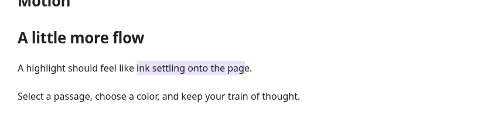

# Annotations

Highlight text and add comments to your Obsidian notes.

Mark a word, a passage, a block, a section, or a complete note. Keep a highlight without a comment. Read your comments in the Annotations side panel.

## Highlight text

1. Open a note in **Live Preview** or **Source mode**.
2. Select the text.
3. Select a color from the toolbar.

On desktop, the toolbar opens above or below the selected text. On mobile, it stays at the bottom of the editor, above the keyboard controls. The highlight saves immediately. A comment is optional. The five colors are yellow, blue, green, purple, and red.

In Live Preview, selecting rendered math annotates the whole equation.

## Add a comment

1. Select the text.
2. Select the speech-bubble icon in the toolbar.
3. Write your comment.
4. Select **Save note**.

You can also save with **Cmd+Enter** on macOS or **Ctrl+Enter** on Windows and Linux.

## Read your comments

Select a highlight to open its comments. To open the panel from the command palette, use **Annotations: Open sidebar**.

- Select a quotation to go to its text.
- Select the search icon to find a comment.
- Select the filter icon to show one highlight color.
- Select the check mark to mark a comment as resolved.
- Select **Open**, **Resolved**, or **All** to change the list.
- Select a comment’s **…** menu to edit or delete the comment.

If you move or delete text, its comment can show **Needs reattachment**. The comment remains available in the panel.

## Comment on a larger area

Put the cursor in the area you want to comment on. Then use one of these commands:

- **Annotations: Comment on current block**
- **Annotations: Comment on current section**
- **Annotations: Comment on current file**

A section starts at a Markdown heading. The file command applies to the complete note.

## Use the keyboard

For keyboard shortcuts, open **Settings → Hotkeys**. Search for **Annotations**.

Use **Escape** to close the comment editor. Use the standard Obsidian commands to undo or redo changes.

## Your workspace

Annotations uses your light or dark theme. On a small screen, the panel opens in a full tab. Animations use your reduced-motion settings.

No account or internet connection is necessary. Annotations does not collect data about how you use it. It does not access files outside your vault.

Use Obsidian 1.8.7 or later.

[Report a problem](https://github.com/arugyani/annotations/issues) · [Developer guide](docs/DEVELOPMENT.md) · [MIT license](LICENSE)
