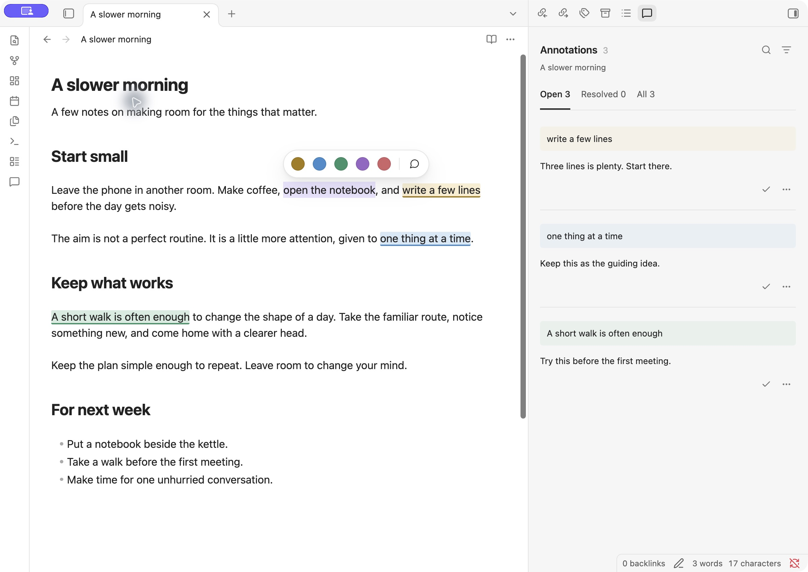
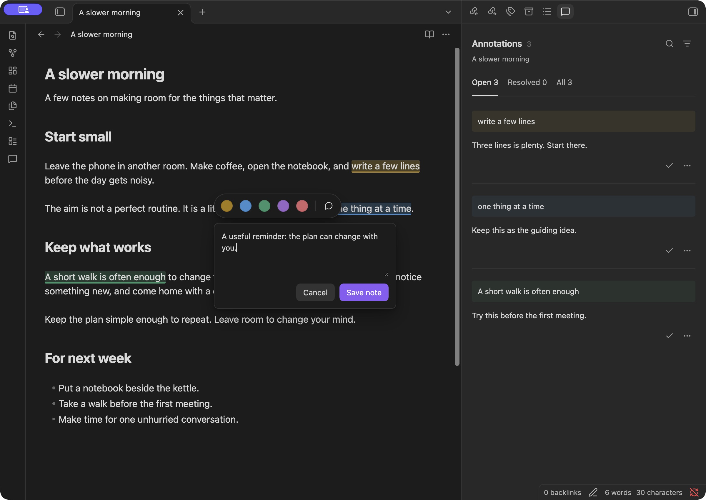
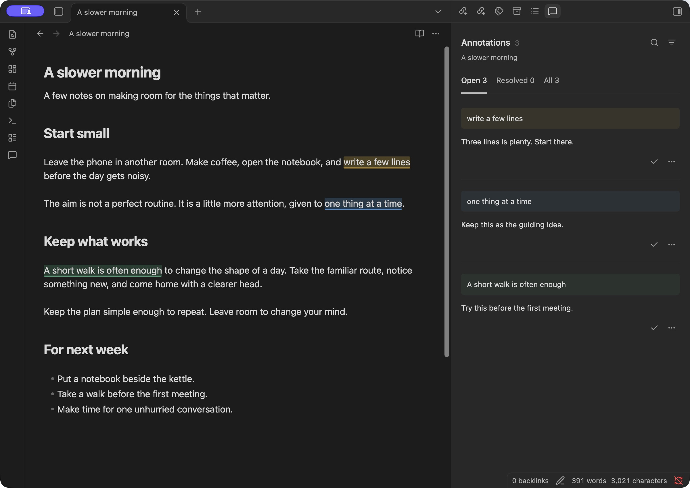
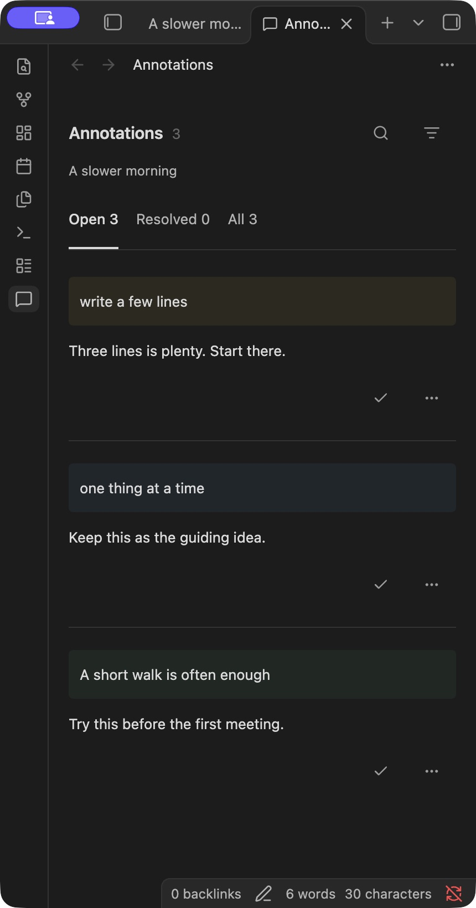

Find detailed documentation in the [comment format guide](docs/FORMAT.md) and [testing notes](docs/TESTING.md).

Annotations is an [Obsidian](https://obsidian.md/) plugin for annotating your notes. Select text, pick a highlight color, and add a note when you need one. You can also comment on a block, section, or entire file. Annotations stay in the Markdown file, with their author, color, status, and target quotation, so you can read them without the plugin.

## About Annotations

- [Screenshots](#screenshots)
- [Installation](#installation)
- [Using Annotations](#using-annotations)
- [Settings](#settings)
- [Highlight colors](#highlight-colors)
- [Hotkeys](#hotkeys)
- [Comment storage](#comment-storage)
- [Contributing](#contributing)
- [Developers](#developers)
- [License](#license)
- [Disclaimer](#disclaimer)

## Screenshots

**Highlight first, write when needed.** The selection pill offers five colors and a small inline note editor.



**Light and dark modes** follow your Obsidian theme. Annotations sit alongside the note, with quotations that take you back to the source.



**Small windows** open Annotations in a full tab, with larger touch targets. This screenshot shows a narrow desktop window; actual iOS and Android devices have not been tested.



## Installation

To install the plugin manually

- [Download Annotations](https://github.com/arugyani/annotations/releases) and extract the archive
- Copy the `annotations` folder into your vault's `.obsidian/plugins/` folder
- Open Obsidian Settings and go to `Community plugins`
- Enable community plugins if needed, then enable **Annotations**
- Reload Obsidian if the plugin does not appear

To update an existing installation, replace the three plugin files with the files from version **1.0.7**, then reload Obsidian. Existing comments need no migration.

Early manual builds used the ID `comments`, which belongs to another community plugin. When upgrading one of those builds, disable it and install the new folder as `annotations`. Copy its `data.json` if you want to preserve your default author, and reassign any hotkeys. Enable only the new build. Existing Markdown annotations need no migration.

The `annotations` folder should contain `manifest.json`, `main.js`, and `styles.css`. You do not need Node.js or a network connection to use the plugin.

To try Annotations in a separate vault, [download the sample vault](https://github.com/arugyani/annotations/releases), extract it, and open the `sample-vault` folder as a new vault in Obsidian. It contains synthetic notes and an installed copy of Annotations.

## Using Annotations

### Add a comment

In Live Preview or Source mode, the floating pill appears as soon as text is selected, while you are still dragging. It stays at the selection’s starting point and opens below upward selections to stay out of the drag path. A 200ms fade and small scale/slide begin once the pill is positioned; extending the selection reuses the same pill without restarting its entrance. System and Obsidian reduced-motion preferences disable this animation. The note icon retains a tooltip and an accessible name. Click a color to save a highlight immediately, then choose the **note icon** to write beside that selection. Save with the button or `Ctrl/Cmd + Enter`. You can also choose the **note icon** directly to create a yellow highlight with a note.

A highlight can exist without a written note. Recolor it from the same pill, use the **note icon** to change its text, or add a note later from the sidebar. Canceling a note leaves an already saved highlight intact.

The context menu and **Annotations: Comment on selection** command remain available as alternatives. To open the inline editor from the keyboard, assign a shortcut to **Annotations: Add note to selection**.

To annotate a larger unit, use the commands for the **current block**, **current section**, or **current file**. Sections follow Markdown `#` headings and ignore headings inside fenced code. A table is treated as a contiguous block.

### Read and manage comments

Open Annotations using the message icon in the ribbon or **Annotations: Open sidebar**.

- Click a quotation to navigate to its target
- Click a highlight to reveal its comments, including overlapping annotations
- Use the check icon to resolve a comment, or the reopen icon to return it to the open list
- Open the **Comment actions** menu (`…`) to edit, reattach, or delete a comment
- Switch between Open, Resolved, and All using the sidebar tabs
- Use the header search icon to search author, quotation, or note text; Escape clears and closes search
- Use the filter icon to choose a color or show annotations needing reattachment

Reading view adds no comment buttons or counters to the page. Exact quotations within a single text node receive keyboard-accessible inline highlights. Targets spanning Markdown formatting remain accessible in the sidebar and through source navigation.

### Reattach a comment

When a target has been deleted or cannot be matched confidently, its comment stays in the file and is marked **Needs reattachment**.

- Open the comment's `…` menu and choose **Reattach**
- Select its new target in the same note
- Run **Annotations: Reattach selected comment to selection**

The original quotation is retained alongside the new target.

## Settings

Open `Settings → Annotations` to set the default **Comment author**. You can change the author and color for an individual comment when writing or editing it.

Hover over a highlight for a compact, left-aligned note preview. Long notes are limited to six preview lines; click the highlight to read the full note in the sidebar. Preview text omits the author and color prefix.

Annotations requires Obsidian 1.8.7 or later and follows its light or dark theme. Below 650 pixels wide, opening Annotations uses a full tab and collapses the side panels.

## Highlight colors

Choose **yellow**, **blue**, **green**, **purple**, or **red** for each comment. Colors have no fixed meaning; use them to organize your own feedback.

Sidebar annotations use softly tinted quotations with accessible color names and resolved status where applicable. Author labels and decorative color stripes are omitted from the sidebar; authorship remains in the stored annotation. Color is not the only way to distinguish annotations. Resolved comments keep their targets, but their editor highlights are hidden.

## Hotkeys

Assign shortcuts in `Settings → Hotkeys` by searching for **Annotations**. Plugin commands have no default key bindings.

### Adding comments

- Add note to selection (inline editor)
- Comment on selection
- Comment on current block
- Comment on current section
- Comment on current file

### Navigation

- Open sidebar
- Show comments at cursor
- Reattach selected comment to selection
- Show/hide stored comment data

In the comment editor, `Ctrl/Cmd + Enter` saves and `Escape` dismisses. Standard Obsidian undo and redo restore both the edited text and its comment anchors. Buttons and action menus support keyboard navigation.

## Comment storage

Annotations are stored in a labeled, versioned HTML-comment footer at the end of each Markdown note. The footer includes the comment body, author, color, status, target quotation, and surrounding context. While Annotations is enabled, a valid footer is invisible in both Source mode and Live Preview, without a counter or placeholder. Use **Annotations: Show/hide stored comment data** from the command palette to inspect it explicitly. Folding is presentation only: it never removes or rewrites the stored data. Malformed or unsupported metadata stays visible for repair. Reading view normally hides the HTML comment.

The note is the authoritative store. There is no comment database, sidecar file, telemetry, network service, payment, or account requirement. The plugin reads and writes only within your vault; it does not access external files. With the plugin disabled, you can read the footer in any text editor or ask an agent to inspect the raw Markdown. The format is self-describing; interpretation by every model is not guaranteed.

Editor changes update the text and its anchors together. External edits use exact quotations and context; ambiguous matches are preserved for manual reattachment. Invalid or unsupported metadata blocks comment writes rather than being overwritten. See the [format guide](docs/FORMAT.md) for the schema, a raw Markdown example, and matching rules.

## Contributing

Found a bug or have an improvement in mind? [Open an issue](https://github.com/arugyani/annotations/issues) or submit a pull request.

For attachment problems, include a small synthetic note, the relevant comment footer, and the steps that caused the problem. For interface issues, include your Obsidian version, theme, and window size. Please remove private note content before sharing examples.

## Developers

### Build instructions

**Set up** (Node.js 24; Python 3 for ZIP packaging)

```sh
npm ci
```

**Check and build**

```sh
npm run validate
```

This builds `main.js` and `styles.css`. Install them alongside `manifest.json` in a dedicated test vault. Obsidian and CodeMirror are supplied by the host app; development dependencies are not installed in a vault.

**Package**

```sh
npm run package
```

This creates the required Obsidian assets, checksums, and plugin/test-vault archives in `release/<version>/`. GitHub supplies the source archive. See the [release guide](docs/RELEASING.md) for local validation, publishing releases, and community submission. No GitHub Actions budget is needed. Run `npx tsx scripts/sample.ts` to regenerate the synthetic sample notes.

### Performance

Typing uses cached editor state, mapped highlights, and reusable comment rows. Reading view shares validated note data through a bounded cache. The distribution adds no runtime dependencies. See [performance measurements](docs/PERFORMANCE.md) for before/after latency, bundle size, and methodology.

### Testing

The test suite covers anchors, overlaps, Unicode, undo/redo, persistence, and malformed metadata. App checks run against separate synthetic vaults in Obsidian 1.15.1 on macOS and Linux. The current screenshots use a synthetic vault on macOS. Automated validation includes Obsidian’s official ESLint rules, storage/anchor tests, DOM tests, and distribution checks.

`scripts/obsidian-test.mjs` requires a running isolated Obsidian instance with a local debugging port at `9223`. It creates and resets named Runtime fixtures in `sample-vault`; use a dedicated test vault only. See [testing notes](docs/TESTING.md) for results, setup details, and limits.

## License

Annotations is licensed under the [MIT License](LICENSE), which allows you to modify and redistribute the code while preserving the copyright and license notice.

## Disclaimer

Annotations requires Obsidian 1.8.7 or later; actual app testing used 1.15.1 on macOS and Linux. iOS, Android, tablet touch interactions, and compatibility with every theme or plugin have not been verified.

Matching is deliberately conservative. Moving a passage that loses both surrounding contexts, or cutting and pasting across separate edits, can require manual reattachment. Targets that span rendered formatting remain available in the sidebar; Reading view only marks exact single-text-node matches.

Long quotations make the footer larger. Very large notes with many comments may need further performance work. Whole-file conflicts remain the responsibility of your sync service; keep normal note backups and file recovery enabled. There is no whole-vault comment dashboard or collaborative merge engine.
