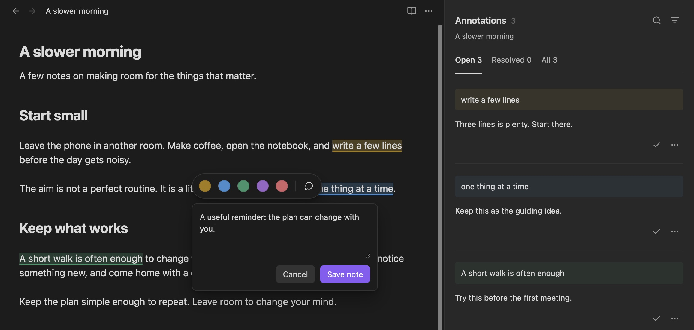

# Annotations

Highlight text and add comments to your Obsidian notes.

Mark a word, a passage, a block, a section, or a complete note. Keep a highlight without a comment. Click a highlight to change its color or edit its comment.

## Highlight text

1. Open a note in **Live Preview** or **Source mode**.
2. Select the text.
3. Select a color from the toolbar.

On desktop, the toolbar opens above or below the selected text. On mobile, it stays at the bottom of the editor, above the keyboard controls. The highlight saves immediately. A comment is optional. The six colors are yellow, blue, green, purple, red, and orange.

On Obsidian 1.14 or later, new highlights on plain text use the native highlight format. They stay visible when Annotations is disabled. Existing annotations and complex selections keep their current format.

In Live Preview, selecting rendered math annotates the whole equation.

## Choose your colors

Open **Settings → Annotations**. Choose **Classic**, **Soft**, or **Earth**, or select a swatch to customize its shade. Use **In pill** to show or hide that color in the toolbar.

Custom shades apply while Annotations is enabled. Highlights still use Obsidian’s six native color slots. With the plugin disabled, native highlights use Obsidian’s colors.

## Add a comment

1. Select the text.
2. Select the speech-bubble icon in the toolbar.
3. Write your comment.
4. Select **Save note**.

You can also save with **Cmd+Enter** on macOS or **Ctrl+Enter** on Windows and Linux.

## Edit a highlight

1. Click or tap an existing highlight to open its toolbar.
2. Select a color to change the highlight, or select the speech-bubble icon to edit its comment.
3. Select **Save note** to save a comment. Click or tap outside the toolbar to close it without removing the highlight.

These controls also work in Reading view. The note stays in Reading view while you edit its annotations.

## Use the side panel

Use the side panel to search and manage annotations in document order. Open it from the command palette with **Annotations: Open sidebar**.

- Each item shows a short passage with the selected words highlighted, and the note underneath.
- Select the passage to jump to its location in the note.
- Type in the search field to find highlighted text or a note.
- Select the filter icon to show one highlight color.
- Use **… → Resolve** to mark an annotation as resolved.
- Select **Open**, **Resolved**, or **All** to change the list.
- Select a note to edit it, or **Add note** to write one.
- Use an annotation’s **…** menu to reattach or delete it.

Use **Select** to manage several annotations. Check individual items or **Select all shown**, then choose **Resolve**, **Reopen**, or **Delete**. Select all applies to the current search and filters; changing filters removes hidden items from the selection. Deletion requires confirmation.

On desktop, **Cmd/Ctrl+A** selects all shown items when the list has focus. **Shift-click** selects a range. **Escape** or **Done** exits selection mode. Search fields keep their standard text-selection shortcuts.

If you move or delete text, its comment can show **Needs reattachment**. The comment remains available in the panel.

## Comment on a larger area

Put the cursor in the area you want to comment on. Then use one of these commands:

- **Annotations: Comment on current block**
- **Annotations: Comment on current section**
- **Annotations: Comment on current file**

A section starts at a Markdown heading. The file command applies to the complete note.

## Use the keyboard

For keyboard shortcuts, open **Settings → Hotkeys**. Search for **Annotations**.

Use **Escape** to close the comment editor. Use the standard Obsidian commands to undo or redo changes.

## Your workspace

Annotations uses your light or dark theme. On a small screen, the panel opens in a full tab. Animations use your reduced-motion settings.

No account or internet connection is necessary. Annotations does not collect data about how you use it. It does not access files outside your vault.

Use Obsidian 1.8.7 or later.

[Report a problem](https://github.com/arugyani/annotations/issues) · [Developer guide](docs/DEVELOPMENT.md) · [MIT license](LICENSE)
